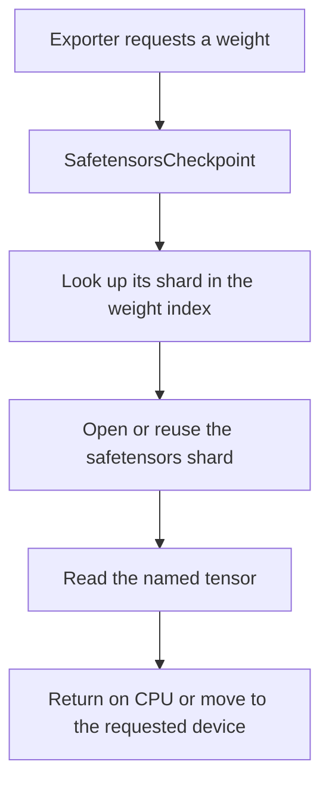

# Nemotron Bolt ONNX exporter

This is a standalone, reorganized version of the root `export_bolt.py` and
`bolt-weights.py` for NVIDIA-Nemotron-3.5-Bolt-74B-A9B-24GB.
The originals are unchanged.

## 1. Graph and weights are different things

For a simple layer:

```text
y = x @ weight + bias
```

- **Graph**: the instructions: `MatMul`, then `Add`, and how they connect.
- **Weights**: the learned numbers in `weight` and `bias`.
- **Checkpoint**: the original files that contain the trained weights.
- **Initializer**: ONNX's description of a constant tensor, such as a weight.
- **External data**: the tensor bytes stored outside the ONNX graph file.

The original exporter already writes two files. The confusing part is that
its Python code handles graph construction and weight writing together.
This version separates those responsibilities:

```text
Python source                         Exported files

checkpoint.py -> quantization.py
                       |
                       v
                tensor_store.py ----> model.onnx.data (large weight arrays)
                       |
                       | names, shapes, types and byte offsets
                       v
graph.py -> layers.py -> model.py ---> model.onnx      (graph + references)
                              ^
                              |
                        export_bolt.py (coordinates the steps)
```

`model.onnx` still contains weight *metadata* and small constants such as axes
and reshape dimensions. The large weight arrays live in `model.onnx.data`.
Keep both files in the same folder; moving just the graph will break loading.
This is not two separate inference stages: the runtime loads the graph and its
referenced weights together.

## 2. Source modules

| File | What to learn |
| --- | --- |
| [export_bolt.py](export_bolt.py) | Parse options, open the checkpoint, build, save. |
| [tensor_store.py](tensor_store.py) | Write bytes and create external-data references. |
| [graph.py](graph.py) | Record nodes and connect them using tensor names. |
| [checkpoint.py](checkpoint.py) | Load configuration and named weights from safetensors shards. |
| [model.py](model.py) | Embeddings, layer loop, residual connections, final logits. |
| [layers.py](layers.py) | Linear layers, Mamba, attention and mixture of experts. |
| [quantization.py](quantization.py) | Decode or repack compact weight formats; read this last. |

### Safetensors weight reader

`SafetensorsCheckpoint` reads the checkpoint JSON files and safetensors shards.
It returns PyTorch tensors, but that does **not** mean the input files are
`.pt` files. In `safe_open(..., "pt")`, `"pt"` selects the returned tensor
framework; the input format is still safetensors.



Shard readers are reused instead of reopening the same file for each weight.
Weights are requested by their original names; no source-name translation or
mixed-source routing is needed.

### Three operations to recognize

```python
weight_name = graph.init("projection.weight", weight_tensor)
result_name = graph.op("MatMul", ["input", weight_name])
shape_name = graph.const([1, -1, 256])
```

- `init` writes a weight externally and returns its name.
- `op` adds a node and returns its output name. It does **not** calculate it.
- `const` puts a small constant directly inside the graph.

These helpers describe the model; inference requires a compatible runtime.

### The Bolt model, in plain language

1. **Embeddings** turn token IDs into vectors.
2. Before each layer, **RMS normalization** rescales the vector.
3. A layer's **mixer** is one of:
   - **Mamba**: a causal convolution and recurrent state update.
   - **Attention**: Q/K/V projections and attention over cached keys/values.
   - **MoE**: a router chooses experts; routed and shared expert results are added.
4. **Residual connections** add each mixer's result back to the running stream.
5. Final normalization and the **language-model head** produce token scores
   called **logits**.

This is the text backbone, not an export of every modality in the checkpoint.
Cache inputs and outputs are still explicit: `past_key`/`present_key`,
`past_value`/`present_value`, `past_conv`/`present_conv` and
`past_ssm`/`present_ssm`. An inference caller must initialize and carry them
between calls; this folder does not implement a text-generation loop.

## 3. Export the checkpoint

Use a Python/platform combination that supports PyTorch.
The inference runtime remains CUDA-oriented.

```powershell
python -m pip install -r export-onnx\requirements.txt
python export-onnx\export_bolt.py --help
python export-onnx\export_bolt.py `
    --model-dir C:\models\NVIDIA-Nemotron-3.5-Bolt-74B-A9B-24GB `
    --out .\bolt-output
```

The model directory must contain `config.json`,
`model.safetensors.index.json`, and the shards referenced by that index.
The script does not download the model. `BOLT_DIR` can replace `--model-dir`.
Use a new or empty output folder; the exporter refuses to overwrite an existing
export. Keep the resulting `model.onnx` and `model.onnx.data` files together.

The default converts dense projections to BF16 and routed experts to int4.
**This is not a small export**: expanding quantized weights can use far more
memory and disk than the original checkpoint. Weight conversion defaults to
CUDA. `--device cpu` changes only where conversion happens; it does not make
the resulting Bolt model runnable on a CPU.

For studying a smaller graph, add `--num-layers 1`. It still loads the embedding
and vocabulary head, is not a valid replacement for the complete model, and
will not generate meaningful text.

Safetensors is the only supported source. The former `--weights` and
`--gguf-path` options have been removed; `BOLT_GGUF` is no longer used.

The `gguf` Python package remains a quantization utility dependency: the
original Bolt safetensors checkpoint contains IQ2_XXS-packed weights whose
codebooks come from `gguf.quants`. It is not used to read GGUF files.
The Q8_0, IQ2_XXS and NVFP4 conversions are still needed for those safetensors
weights. A different model's safetensors files are not automatically compatible:
its architecture, tensor names, configuration and numerical layouts must match
what this Bolt exporter expects.

### Advanced formats and runtime options

The layer math and packing algorithms are carried over from the original:

| Option | Meaning |
| --- | --- |
| `--q8 bf16` / `int8` | Expand Q8_0 dense weights, or keep quantized values and scales. |
| `--iq2 bf16` / `int4` | Expand shared-expert IQ2 weights, or approximately requantize them to int4. |
| `--iq2 lut4` / `native` | Exact custom layouts; require Bolt custom ops. |
| `--experts int4` / `int8` | Routed-expert layouts; int4 is approximate, int8 preserves IQ2 values before scale rounding. |
| `--experts lut4` / `native` | Exact routed-expert layouts; require `--verify-rows`. |
| `--decode --max-len 4096` | Batch 1, fixed-size attention cache buffers. |
| `--fused` | Replace selected operation chains with this repository's Bolt CUDA ops; requires decode mode. |
| `--verify-rows 2` | Static multi-token verification; implies decode and fused, supports 1..8 rows. |
| `--dt-min 0` | No lower clamp on Mamba's time step, matching the original default. |
| `--aux` | Also emit residuals at the six configured auxiliary layers. |
| `--debug-layers 0 1` | Also emit selected mixer results. |

LUT4 dense projections need 2..8 verification rows. Native experts need the
verification path. Invalid layout/runtime combinations are rejected rather
than silently producing a graph whose runtime interprets the bytes incorrectly.

For example, the native verification layout:

```powershell
python export-onnx\export_bolt.py `
    --model-dir C:\models\NVIDIA-Nemotron-3.5-Bolt-74B-A9B-24GB `
    --out .\bolt-native-output `
    --verify-rows 2 --q8 int8 --iq2 native --experts native
```

**Exporting is not the same as running.** The real graph uses ONNX Runtime
contrib operations (`com.microsoft`) and, when fused, the repository's `bolt`
custom-op library. It is not a portable standard-ONNX CPU model. You need a
compatible ORT CUDA build with the required contrib ops, plus the custom
library for fused mode; see the [root README](../README.md) for the CUDA build.
The graph explicitly imports the `bolt` domain in fused mode.

The full graph retains the original ORT-specific normalization operations,
so a generic ONNX checker is not a substitute for testing that ORT build.

## 4. Run the tests

```powershell
python -m unittest discover -s export-onnx -p "test_*.py" -v
```

Lightweight tests verify external weight references,
alignment, scalars, file closure and CLI validation. With full dependencies
installed, additional CPU tests check checkpoint loading, quantization and
small synthetic Mamba/attention/MoE graphs in multiple export modes.
Loader tests cover configuration/index loading, shard reuse, cross-shard
stacking, missing weights and missing shard errors.
Export tests also
compare graph operations, connections, attributes, input/output signatures and
weight bytes with the original exporter in five modes. They do not require
model downloads or CUDA. These are export tests, not evidence of
numerical equivalence of full-model CUDA inference on the real checkpoint.
