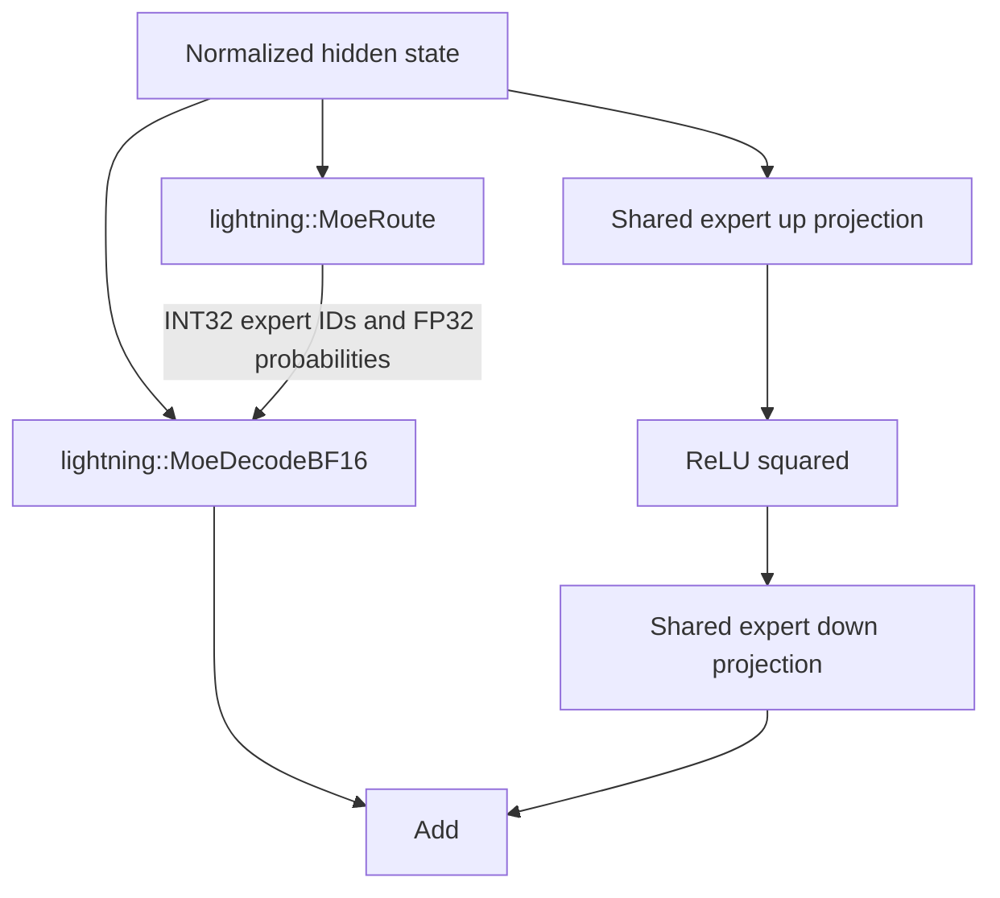

# 2. Bolt-style custom BF16

This version follows the coworker's **fusion boundaries and decode structure**,
not the earlier independently designed `MambaDecode`/`RoutedExperts*` draft.

```bash
python 02-custom/export.py --model-dir /models/lightning --out /models/onnx-custom
```



Other blocks follow projection -> `lightning::MambaStep` -> output projection,
or Q/K/V projections -> ORT GQA -> output projection. Residual and normalization
remain in the outer model, as in the original exporter.

| Surface | Bolt design | Lightning adaptation |
| --- | --- | --- |
| Router | `MoeRoute` | Same fused role, guarded loads for width 2688 |
| Mamba | `MambaStep`, FP32 state `[B,heads,state,dim]` | Same operation name, input order and state convention |
| Experts | Quantized `MoeDecode`, latent width 1024 | BF16 `MoeDecodeBF16`, direct width 2688 |
| Shared experts | Separate branch + Add | Same structure |
| Dense projections | Packed low-bit kernels where applicable | BF16 MatMul |
| Verification | Separate multi-row ops | Not implemented here |

There are **no invented latent projections**. Lightning's checkpoint contains
neither Bolt's `fc1_latent_proj` nor `fc2_latent_proj`.

The new library source is [src/lightning/lightning_ops.cu](../../src/lightning/lightning_ops.cu),
with its [standalone CMake project and kernel guide](../../src/lightning/README.md).
It adapts the local [Bolt source](../../src/bolt/bolt_ops.cu); it does not register
under `bolt` because it is not binary-compatible with the original library.
Mamba norm weights use the same FP32 input type as Bolt, but preserve
Lightning's BF16 normalization rounding. BF16 expert execution is an extension
needed for the unquantized baseline.

Read the custom branches in [layers.py](../shared/layers.py) beside the
[original exporter](../../export_bolt.py), then inspect the CUDA implementation.
See the [main guide](../README.md) for build/test commands. These kernels must
be compiled and validated on H100; matching graph structure does not establish
equal speed or correctness.
