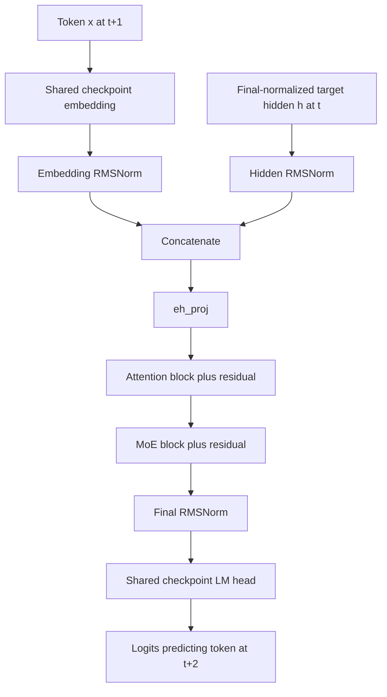

# 4. Separate MTP draft stage

The checkpoint has one prediction stage consisting of **attention then MoE**.
This is not another full target backbone.

```bash
# Explicit BF16 expert math:
python 04-mtp/export.py --model-dir /models/lightning --out /models/onnx-mtp

# Bolt-style fused router and BF16 expert decode:
python 04-mtp/export.py --model-dir /models/lightning \
  --out /models/onnx-mtp-custom --mtp-backend custom
```



Use an aligned target capture from the [main guide](../README.md):

```bash
python run.py --export /models/onnx-mtp-custom --custom-library "$LIGHTNING_OPS" \
  --mtp-target-record custom.npz --record mtp.npz
```

The runner pairs target `hidden_states[:-1]` with `token_ids[1:]`. The MTP cache
is separate and must describe that aligned draft history. It cannot consume an
arbitrary target cache. MTP logits must not be directly compared with target
logits as though they were the same model/output position.

Shard 14 contains MTP-specific weights, but the complete source checkpoint is
needed for embedding and LM-head tensors in other shards. This export copies
those tensors into its own data file; no cross-session GPU weight sharing is
implemented.

The tests compare this graph with independent eager MTP math on synthetic
inputs. A complete speculative controller, multi-row target verification,
acceptance/rejection and cache rollback are not supplied by this exporter.
